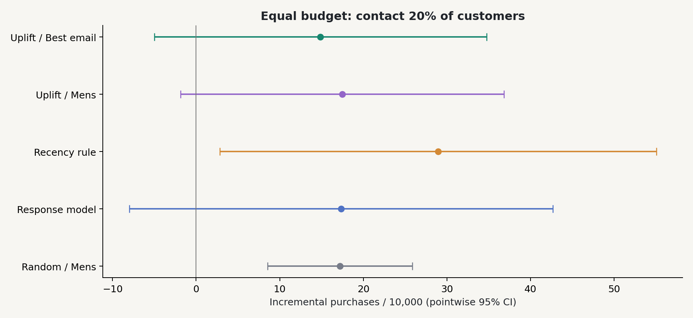
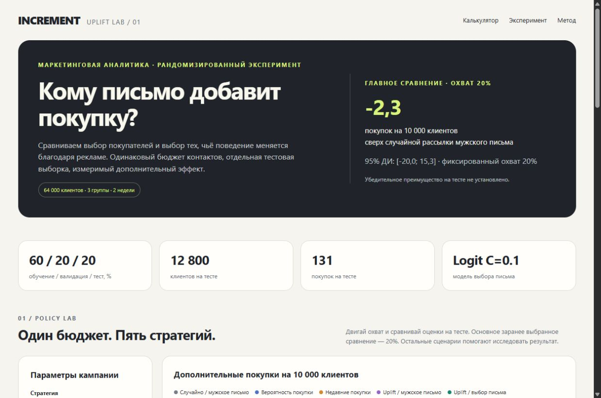

# INCREMENT — Uplift Lab

**Who should receive an email when the contact budget is limited?**

A reproducible marketing analytics portfolio project built on the randomized
Hillstrom email experiment: SQL metrics, experiment checks, uplift modeling,
held-out policy evaluation, and an offline campaign calculator.

## Main finding

Email campaigns increase average conversion in this experiment. However, the
selected personalization policy does **not demonstrate an improvement over a
random Mens-email campaign at 20% contact coverage**.

On the held-out test, personalization minus random targeting is **−2.3 additional
purchases per 10,000 customers (95% CI: −20.0 to +15.3)**.
This is uncertainty about the difference, not proof that the policies are equal.

| Strategy, 20% contacts | Incremental purchases / 10,000 | Pointwise 95% CI |
|---|---:|---:|
| Random targeting, Mens email | 17.2 | 8.5 to 25.9 |
| Response ranking | 17.3 | −8.0 to 42.7 |
| Recency business rule | 29.0 | 2.9 to 55.1 |
| Binary uplift, Mens email | 17.5 | −1.9 to 36.9 |
| Multi-arm uplift | 14.9 | −5.0 to 34.8 |

The recency rule has a higher point estimate, but its paired difference from random
also includes zero. It is an exploratory comparison, not an established winner.

## Explore the deliverables

- **Open reports/dashboard.html** in a browser. It is self-contained and works offline.
  On Windows, double-click **open_dashboard.cmd**.
- [Business report in Russian](reports/REPORT_RU.md)
- [Executed walkthrough notebook](notebooks/01_uplift_walkthrough.ipynb)
- [Interview preparation in Russian](INTERVIEW_RU.md)
- [Study sequence](START_HERE_RU.md)
- [Machine-readable results](reports/results.json)
- [Test policy comparisons](reports/tables/test_paired_comparisons.csv)

## Reproduce

Python **3.12** is recommended. From this project directory:

~~~bash
python -m venv .venv
# Windows: .venv\Scripts\activate
# macOS/Linux: source .venv/bin/activate
python -m pip install -r requirements-dev.txt
python run.py
python scripts/build_notebook.py
python -m pytest -q
~~~

run.py downloads the public data if absent, validates its checksum, builds the
DuckDB mart, trains candidates, locks validation decisions, evaluates the holdout,
and rebuilds tables, figures, dashboard, and report. Runtime depends on the machine.

The local folder already includes downloaded data and computed artifacts.
The shareable ZIP and Git configuration omit raw and processed customer-level data.
After extracting the ZIP, run the commands above to reconstruct those inputs;
the dashboard, report, figures and saved notebook outputs can be viewed immediately.

## Analysis design

- 64,000 customers; three randomized actions: no email, Mens email, Womens email.
- Primary outcome: conversion within two weeks. Visits and spend are secondary.
- 60/20/20 split, stratified by assigned arm only; seeds 42 and 43.
- T-learners: logistic regression C=0.1, C=1, shallow histogram gradient boosting.
- Model selection: validation AIPW incremental conversions at 20% contact coverage.
- Binary and multi-arm models selected separately; both select C=0.1 in this run.
- Final models fit train+validation; holdout outcomes never used for fitting or selection.
- The response baseline and binary uplift use the same fitted outcome models,
  isolating the difference between response and incremental-effect ranking.
- AIPW uses known assignment probabilities 1/3 and independently fitted outcome
  regressions. Plain IPW estimates are exported as a sensitivity diagnostic.
- Primary contrast: multi-arm vs random Mens targeting at 20% contacts.
- Other coverages and segment comparisons are exploratory.
- Six average-effect p-values use Holm adjustment. Displayed CIs are individual,
  unadjusted 95% intervals.
- Unnormalized binary Qini is defined explicitly in src/core.py and the report.

## Calculator

Change strategy, contact coverage, population size, cost per contact, and assumed
contribution margin per incremental purchase. Every strategy uses the same contact
budget. A 0% option turns the campaign off.

The profit display is a **scenario**, not observed profit. It assumes a fixed
average contribution per additional conversion. Extrapolation to a new population
assumes comparable customers and stable effects. Do not choose an allegedly
optimal policy by maximizing a noisy test curve.

## Project structure

~~~text
run.py                         end-to-end analysis
src/core.py                    learners, allocation, AIPW, Qini, inference
src/reporting.py               report and figure generation
src/dashboard.html             offline dashboard source template
sql/                           DuckDB mart, metrics, exploratory segments
scripts/download_data.py       checksum-verified public data retrieval
scripts/build_notebook.py      executed educational notebook builder
notebooks/                     completed walkthrough
tests/                         synthetic estimator and saved-result checks
reports/                       dashboard, memo, tables, figures, decisions
data/raw/                      local source data and provenance manifest
data/processed/                local DuckDB, split map, holdout predictions
~~~

## Validation

10 pytest checks passed on the completed local analysis, including a synthetic
known-effect recovery test and independent reconstruction of the main held-out
contrast. CI runs the formula tests; saved-output checks run when analysis data
exists. Browser checks covered rendered values, zero coverage, strategy changes,
population scaling and rejection of negative costs. See reports/VALIDATION.md.

## Limitations

Only 131 conversions occur in the test set, so policy differences are noisy.
Intervals are normal approximations conditional on trained models and approximately
fixed budget thresholds; they do not include repeated-training or threshold
estimation uncertainty, nor simultaneous coverage across the policy grid.
Data is historical (2008); no long-term opt-outs, contact fatigue, or actual
campaign costs are observed. Individual causal effects cannot be verified.

## Data and attribution

Kevin Hillstrom's MineThatData E-Mail Analytics and Data Mining Challenge (2008).
[Original description](https://blog.minethatdata.com/2008/03/minethatdata-e-mail-analytics-and-data.html).
A mirror and expected MD5 are documented in
[scikit-uplift's loader](https://www.uplift-modeling.com/en/latest/_modules/sklift/datasets/datasets.html#fetch_hillstrom).
Read [DATA_SOURCES.md](DATA_SOURCES.md) before redistributing data.

Project source code is MIT licensed. Source data has its own rights; the code
license does not grant a license to the dataset.

